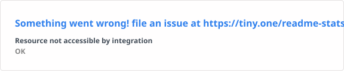

<h1>Hi 👋, I'm Abhishek Dodamani</h1>

<h3>Junior Python Backend Developer | Flask • Django • REST APIs • SQL • Git</h3>

  <b>Building • Learning • Debugging • Shipping</b>

  
  &nbsp;&nbsp;
  

---

## 👨‍💻 About Me

I'm **Abhishek Dodamani**, a final-year B.Tech Computer Science student and Junior Python Backend Developer.

I enjoy building backend systems, REST APIs, automation workflows, database-driven applications, and practical AI/ML projects.

- 🔭 Currently building and improving backend & AI/ML projects
- 🌱 Learning advanced backend development, cloud technologies and AI
- 💻 Strong focus on Python backend development
- ☁️ Experience with AWS, Azure and GCP
- 🗄️ Interested in APIs, databases, automation and scalable systems
- 🧪 Focused on debugging, testing and clean documentation
- 🚀 Open to internships, backend opportunities and collaborative projects

---

## 🛠️ Tech Stack

### 🐍 Languages

### ⚙️ Backend

### 🤖 Data & AI

### ☁️ Cloud & Tools

---

## 🚀 Featured Projects

### 🚦 AI-Based Traffic Density Management System

Real-time traffic monitoring system built with Python and a Streamlit dashboard to display traffic metrics.

### 🔐 Biometric Authentication System

CNN-based authentication system designed with data security and access-control considerations.

### 🎯 Real-Time Object Detection & Tracking

Real-time computer vision pipeline using CNN and OpenCV for object detection and tracking.

---

## 💼 Experience

### Python & Systems Support Engineer Intern

**Q TechSolutions Pvt. Ltd.**

- Diagnosed and fixed backend/API issues.
- Reduced average API response time by approximately **30%**.
- Automated Python data migrations and workflows.
- Reduced manual processing effort by approximately **50%**.
- Followed testing, documentation and release SOPs.

### Python Development Intern

**Infotact Solutions**

- Built and debugged backend automation tools and APIs.
- Integrated applications with databases.
- Participated in code reviews and documentation.

### Data Science & Analytics Intern

**Zidio Development**

- Built Power BI dashboards and status reports.
- Processed structured datasets and checked data quality.

---

## 📊 GitHub Statistics

  

---

## 🐍 Contribution Snake

> ⏳ Snake animation will appear after the GitHub Actions workflow is configured.

---

## 🎓 Education

**Bachelor of Technology — Computer Science**

PRIST Deemed to be University  
**2023 – 2027**

---

## 📜 Certifications

- PCAP: Programming Essentials in Python
- Cloud Computing — NPTEL
- DBMS — NPTEL
- Power BI for Data Analytics
- Machine Learning / AI
- 36-HOUR DATA STRUCTURE ANALYSIS TRAINING

---

## 🌐 Connect With Me

